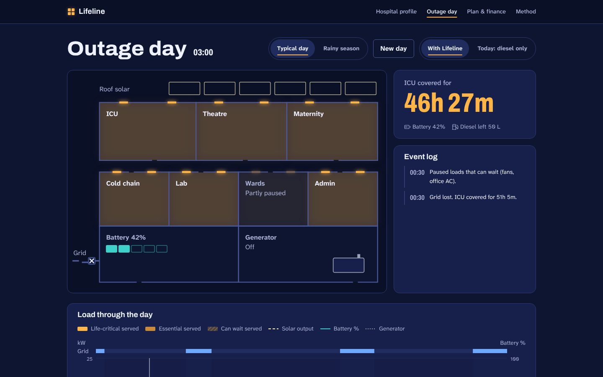

# Lifeline — hospital power continuity

Lifeline sizes solar, batteries and an inverter for Nigerian hospitals, alongside their existing diesel generator, then plays a full day of grid outages to show, minute by minute, that life-critical care stays powered. It ends with an Energy-as-a-Service price the hospital can pay monthly instead of buying the system up front.

Built for the Global Energy Hackathon 2026 (Anneru Solutions), Availability pillar, non-residential (healthcare) track.



## The problem

The Availability problem statement we chose, verbatim:

> "Design a scalable, low-maintenance energy system that guarantees uninterrupted 24-hour power for Nigerian hospitals experiencing 8–20 hours of daily grid outages, ensuring critical medical equipment, refrigeration, lighting, and life-support systems never fail due to electricity unavailability."

Lifeline compares two versions of the same hospital. "Today: diesel only" falls back on its generator: each outage starts with a gap while the generator is started by hand, and the monthly diesel budget can run out. "With Lifeline" adds solar and a battery, sorts every load into three priorities (life-critical, essential and can wait), sizes the system around the first two, and runs a controller that pauses lower-priority loads before life-critical equipment is ever at risk.

## What it does

Five screens:

1. **Home.** The problem in one screen, with sourced facts and the "Simulate an outage" button.
2. **Hospital profile.** Start from a preset (General Hospital, Kano, 50 beds, or Primary Health Centre, FCT) or list your own equipment by ward. Set the state, beds, grid hours a day, diesel per month and generator size.
3. **Outage day.** A living floor plan of the hospital through 24 hours in 15-minute steps. Rooms light up, dim or show "No power" as the grid comes and goes. Alongside it: how long the ICU is covered for, an event log, a load chart, and a side-by-side comparison of "Today: diesel only" against "With Lifeline", ending in a verdict.
4. **Plan & finance.** Solar, battery and inverter sizes; the monthly fee against today's energy spend; upfront cost, payback, return and CO₂ avoided for the investor; every price assumption editable; and a one-page proposal to download.
5. **Method & sources.** The formulas, every sourced default value with its source (and its date where known), the model settings explained, and the model's limits.

### Demo path

Home → **Simulate an outage** → the outage day plays (switch to 16× to see the whole day in a few seconds) → **Plan & finance** → **Download proposal** (opens the print dialog; save as PDF for a one-page A4 proposal).

With the default settings (General Hospital, Kano, 50 beds, a typical day), the app shows:

- **Today: diesel only.** Life-critical equipment goes 5h 15m without power during the day.
- **With Lifeline.** 0 minutes without power, and ₦156K saved that day.
- **Plan.** 41 kWp of solar, 85 kWh of lithium (LFP) storage and a 12 kW inverter. At a fee of 80% of today's spend, the hospital saves ₦13.7M a year.
- **For the investor.** ₦44.1M upfront, paid back in about 1 year, with a 103% annual return over a 10-year contract.

All figures come from the model in `src/engine/` at the default assumptions, which you can change on the profile and plan pages.

### If diesel gets cheaper

The finance case is driven mostly by diesel, which the default prices at ₦3,277 per litre (NBS, May 2026). At the February 2026 NBS average of ₦1,420 per litre, the same hospital still saves ₦6.9M a year. The investor's payback grows to 2.4 years and the return falls to 40% a year. Life-critical care stays powered at either price, because the price does not change the system size or the controller. To check another price, edit "Diesel price" under Assumptions on the plan page.

## How to run

You need Node.js 20.19 or later (or 22.12 or later).

```bash
npm i            # install dependencies
npm run dev      # start the app at http://localhost:5173
npm test         # run the unit and component tests
npm run lint     # lint
npm run build    # type-check and build the static site into dist/
```

There is no backend. Every calculation runs in the browser, so the built `dist/` folder can be served from any static host.

To deploy on Vercel:

```bash
npx vercel          # first time only: log in and link the project
npx vercel --prod   # build and publish
```

## Method in short

The Method page in the app has the full detail and the formulas.

**Sizing.** Lifeline sizes for the load it must keep on: life-critical plus essential. Loads that can wait are not sized for, because the controller pauses them first.

- Battery size = night energy × outage share of the night ÷ (0.8 usable × 0.9 round trip), rounded up to the next 5 kWh.
- Solar size = daily energy × share of the day without grid ÷ 0.9 round trip ÷ (worst-month sun hours × 0.75 performance ratio), rounded up to the next 1 kWp. Sun hours are for the month with the least sun in the hospital's state (August in most states, when the rains are heaviest).
- Inverter size = 1.25 × peak load, rounded up to the next 1 kW.

**The controller.** The simulation steps through one day in 15-minute steps. It runs the day twice and shows the second run, so the battery starts at a realistic charge.

- With the grid up, everything is served, and the battery charges from spare solar first, then from the grid.
- In an outage, the controller looks ahead to the next time the grid returns or the sun is strong (08:00–16:00), and compares the energy the loads need until then with the battery energy above a 20% reserve.
- Loads that can wait are paused first, whenever the battery alone cannot carry everything. Before pausing essential loads, the controller also counts the diesel the generator can supply until the grid returns or the sun is strong. It counts only fuel that life-critical load will not need for the rest of the day, and only if the generator and a day's fuel could carry life-critical load on their own. Paused loads come back only with a 20% margin. Life-critical load is never paused.
- Power comes from solar first, then the battery down to its reserve, then the generator, and last the battery's reserve.
- "Today: diesel only" starts each outage with a 15-minute gap while the generator is started by hand. The generator then serves life-critical load first until the fuel runs out.

**The money (Energy-as-a-Service).** A provider installs and runs the system. The hospital pays a monthly fee set below what it spends on grid power and diesel today (80% by default, adjustable from 70% to 85%). The provider pays the leftover grid and diesel and the operations and maintenance.

- Today's annual spend = daily energy cost × 365 + generator maintenance.
- Upfront cost = solar, battery and inverter at their unit prices, plus 15% for wiring, protection and engineering.
- Hospital saves per year = today's annual spend − 12 × monthly fee.
- Payback and return (IRR) are worked out for the provider over a 10-year contract. When the provider has no positive cash flow, they show "n/a".

## Sources

Every sourced default value in the app is listed with its source, and its date where known. Open **Method & sources** in the app to see each one and whether it is an estimate. The model settings (0.8 usable, 0.9 round trip, 0.75 performance ratio, 1.25 headroom and the 20% battery reserve) are not sourced values; the Method page explains them. The key sources:

- Diesel price, ₦3,277 per litre: NBS Diesel Price Watch, May 2026 average retail, reported by [Legit.ng](https://www.legit.ng/business-economy/energy/1716140-nbs-diesel-price-rises-8640-n3277litre-2026/).
- Grid tariff, ₦209.5 per kWh: NERC Band A tariff, [Leadership](https://leadership.ng/?p=484864).
- Battery cost: LFP at ₦183,000–221,000 per kWh, [PowMr Nigeria 2026](https://af.powmr.com/blogs/news/how-much-is-solar-battery-in-nigeria).
- Solar cost and exchange rate: calibrated to [SurgePV](https://www.surgepv.com/solar-compliance/nigeria/guides/ci-solar-nigeria)'s ₦150–200M commercial benchmark, and its Q2 2026 rate of ₦1,600 per US dollar.
- Sunshine: [NASA POWER](https://power.larc.nasa.gov/) Climatology API, all-sky surface solar radiation (`ALLSKY_SFC_SW_DWN`) averaged over 2001–2025 at each state capital.
- Equipment power draw: [SEforALL, *Medical appliances for resource-constrained settings*, July 2025](https://www.seforall.org/system/files/2025-07/SEforALL%20report-medical-appliances-resource-constrained-settings.pdf), field tests of oxygen concentrators, infant warmers and autoclaves. Other ratings are typical manufacturer figures, marked as estimates.
- Diesel CO₂: 2.68 kg per litre, the standard combustion factor (DEFRA/EPA).
- Context on the home page: [Nigeria Health Watch](https://nigeriahealthwatch.com/articles/torchlight/a-solar-power-project-is-keeping-primary-healthcare-centres-running-in-abuja/) (primary health centres without electricity), [WHO AFRO](https://www.afro.who.int/pt/node/23032) (solar at two Nigerian health centres), [SolarQuarter](https://solarquarter.com/2025/09/20/nigerias-energy-commission-launches-7mw-solar-project-at-aminu-kano-teaching-hospital/) (Aminu Kano Teaching Hospital), and the Nigeria Power for Health Initiative ([Guardian NG](https://guardian.ng/?p=2861639), [Nairametrics](https://nairametrics.com/2025/09/09/tinubu-unveils-energy-reform-plans-set-to-end-power-supply-crisis-in-nigerian-hospitals/)).

## Limits

- Simulates one representative day, not a full year.
- Equipment ratings are typical values, not a site audit. Field tests found real draw differs from labels by −45% to +56%.
- Prices were checked in October 2026 (diesel is the May 2026 NBS average) and change fast; edit them on the plan page.
- The grid outage pattern is generated, not measured. Real feeder data would replace it in a pilot.

## Accessibility

The app is built to be used without a mouse and with a screen reader. Every control is keyboard operable, including playback and the floor plan's rooms. The event log announces what happens during the day. Priorities are always written out, never shown by colour alone. Reduced-motion settings are respected: animations stop, and playback still works.

## Stack

React and TypeScript (strict), built with Vite. Charts use Recharts, animation uses `motion`, and icons come from `lucide-react`. Tests use Vitest, Testing Library and jsdom, and linting uses oxlint. The model in `src/engine/` is plain TypeScript with its own unit tests, separate from the interface.

## Team

Shivansh Gautam
